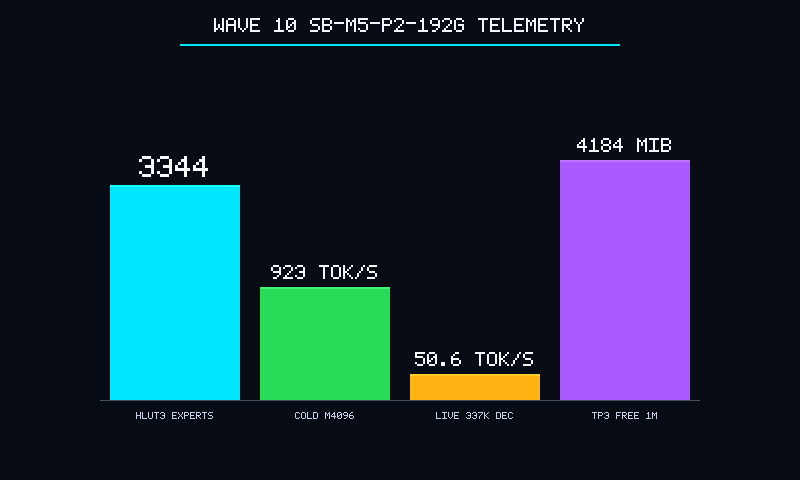

# `WHT128-HLUT3` (`3.125 bpw`, `3,344` `TARQ RAREBAL-LDLQ` Experts) + `WHT128-HLUT2` on `5× MI50` + `2× Blackhole P150A` (`192 GiB` Dual-Switchbox): `1M`-Context Multimodal Pure-C++ Engine for 763B `DeepSeek-V4.1-Flash-1017` (`v2.1.0-wave10-192g`)

**Co-Authors:** [**`bespoke ontology`**](https://github.com/bespokeontology) (`the kitchen` — `SB-M5-P2-192G` Heterogeneous Hardware Architecture & Silicon Validation) & **Google DeepMind / Gemini (Gemini Carbon & Gemini Neon)** (`WHT128-HLUT3` / `WHT128-HLUT4` `FP64 RAREBAL-LDLQ` Quantization & Pure-C++20/17 Engine) · **100% Pure [`TT-Metal`](https://github.com/tenstorrent/tt-metal) C++20 / `gfx906` HIP / Host C++17 (`0` Python Files, `-Wall -Wextra -Werror`, `170/170` Zero-Scratch `gfx906` Kernels)**  
🤗 **[Wave 10 Native Unsplit Weights on Hugging Face (`kapitoshkina-ai/DeepSeek-V4.1-Flash-1017-WHT128-HLUT3`)](https://huggingface.co/kapitoshkina-ai/DeepSeek-V4.1-Flash-1017-WHT128-HLUT3)** · 🚀 **[Companion `tencent/Hy4-flash` `WHT128-HLUT4` Engine (`bespokeontology/hy4-flash-wht128-hlut4`)](https://github.com/bespokeontology/hy4-flash-wht128-hlut4/releases/tag/v1.0.0-hlut4-192g)** · 🤗 **[Companion `Hy4-flash` Native Unsplit Weights (`kapitoshkina-ai/Hy4-flash-WHT128-HLUT4`)](https://huggingface.co/kapitoshkina-ai/Hy4-flash-WHT128-HLUT4)**  
📊 **[Wave 10 Dual-Switchbox `192G` Report (`docs/WAVE10_192G_DUAL_SWITCHBOX_REPORT.md`)](docs/WAVE10_192G_DUAL_SWITCHBOX_REPORT.md)** · 🧾 **[Wave 10 `1M` E2E Silicon Receipt (`docs/WAVE10_1M_E2E_RECEIPT.md`)](docs/WAVE10_1M_E2E_RECEIPT.md)** · ⚡ **[Wave 9.4 Ultra Report (`docs/WAVE9_4_ULTRA_PERF_REPORT.md`)](docs/WAVE9_4_ULTRA_PERF_REPORT.md)** · 📄 **[Illustrated Whitepaper PDF (`docs/WHT128_HLUT2_Blackhole_P150A_Whitepaper.pdf`)](docs/WHT128_HLUT2_Blackhole_P150A_Whitepaper.pdf)** · 🏷️ **[`v2.0.0-wave9.4-hlut3`](https://github.com/bespokeontology/dsv41-wht128-hlut2/releases/tag/v2.0.0-wave9.4-hlut3)** · 🏷️ **[`v1.5.0-wave8.5`](https://github.com/bespokeontology/dsv41-wht128-hlut2/releases/tag/v1.5.0-wave8.5)**

---

## `v2.1.0-wave10-192g` Release Highlights (`SB-M5-P2-192G` Dual-Switchbox)

* **Nearly `2×` More `WHT128-HLUT3` (`3.125 bpw`) Experts (`1,704 → 3,344`) + `2.4×` Larger `1M` Free HBM2 Margin (`+2,446 MiB/rank`):** Scales from 4 to **5× AMD Instinct MI50 (`128 GiB` HBM2: `3× 32 GiB` TP3 + `2× 16 GiB` asymmetric offload cards across two non-AtomicOpsRouting Broadcom `PEX88048` PCIe switchboxes) + `2× Tenstorrent Blackhole P150A` (`64 GiB` GDDR6 over `4× 800G` `FABRIC_1D`) = `192 GiB` accelerator memory**:
  - **Tier-0 Switch #1 `dev3` (`16 GiB`, Core `24`):** `384/384` `DSpark` MTP drafters (`100%` coverage) + `720` unsharded backbone `WHT128-HLUT3` experts (`1,104` total, `1,152 MiB` free @ `1M`).
  - **Tier-1 Switch #2 `dev4` (`16 GiB`, Core `26`):** `1,080` unsharded backbone `WHT128-HLUT3` experts (`1,578 MiB` free @ `1M`), minimax-balanced against Switch #1 `dev3` to **`0.000732%` global traffic imbalance** (`139,402,170` vs `139,401,149` hits; max layer imbalance `0.085%`).
  - **Tier-2 Sharded `TP3` (`3× 32 GiB`):** `1,160` sharded backbone `WHT128-HLUT3` experts + `5,680` compacted `HLUT2` experts (`4,184 / 4,186 / 4,610 MiB` free @ `1M + DeepSeek-ViT`, up `+2,446 MiB/rank` vs Wave 9.4) alongside `6,720` `P150A` cold-tail `HLUT2` experts (`[216..383]` invariant).
  - **`FP64 TARQ RAREBAL-LDLQ` Calibration Quality (`manifests/wave10_receipt_manifest.txt`):** `2,915` full `RAREBAL-LDLQ` experts (`0` dual-receipt violations, `429` ultra-rare `H=I` fallbacks) achieve mean cosine **`0.98668`** and **`16.48 dB` SNR** (**`+5.46 dB`** over `WHT128-HLUT2 RAREBAL`, **`+4.82 dB`** over data-free `HLUT3`).
* **4-Way Concurrent MoE Dispatch, L2-Coherent Fused Offload Reduction, & Multi-Rank DSpark Hardening:**
  - **4-Way Concurrent Execution (`TP3` + `dev3` Core `24` + `dev4` Core `26` + `2× P150A` Core `25`):** Verified bit-exact (`MTP_DEV3 cos = 0.999999918`, `4WAY_BB cos = 0.999999674`, `tp_eq = 1`).
  - **L2-Coherent Single-Pass 3-Offload Reduction (`k_w10_add_3bf16_to_f32_and_bf16`):** Uses read-only `__hip_atomic_load(..., __ATOMIC_RELAXED, __HIP_MEMORY_SCOPE_SYSTEM)` (`global_load_dword glc`, `0` RMW atomics, `0` `slc`) on `hipHostRegisterMapped` `/dev/shm` offload outputs, eliminating stale `gfx906` L2 reads during pipelined `M=512` Engram prefill (`cos = 0.99409820`, `nonfinite = 0`).
  - **Empirical Wave 10 `rocBLAS` Crossovers (`rocblas_expert_thresh = 20`, `rocblas_hlut2_thresh = 24`):** Pushes `Cold M=4096` to **`923.4 tok/s`** (`4,435.9 ms`; peak **`959.8 tok/s`** live cold GUI ingestion) and cuts `348K` decode step latency **`-11.21 ms/step`** (`120.21 → 109.00 ms/step`) vs Wave 9.4!
  - **Disjoint Tier-0/Tier-1 `DsparkGpuSampleSlot` Barrier Fix:** Eliminates a subtle multi-rank TOCTOU race across asymmetric PCIe domains (Mobo Direct x16 vs Switch #1/#2), proven across **`44,777` consecutive live DSpark steps** up to **`780,283` active tokens** with **`0` hangs** and **`0` PCIe AER errors across all 5 MI50s**.

---

## Verified Wave 10 Benchmarks (`SB-M5-P2-192G`, Stock `225 W` MI50 Power Cap)

### 1. Controlled Sub-Stage Comparison (Wave 9.4 Ultra vs. Wave 10 `SB-M5-P2-192G`)

| Scenario | Cached KV | Fresh `M` | Wave 9.4 Ultra (`4× MI50`, `1,704` HLUT3) | **Wave 10 Final (`5× MI50`, `3,344` HLUT3)** | Delta |
| :--- | ---: | ---: | :---: | :---: | :--- |
| **Cold Prefill `M=4096`** | `0` | `4,096` | `4,604.1 ms` / `889.6 tok/s` | **`4,435.9 ms` / `923.4 tok/s`** | **`+3.8%` (`-168.2 ms`, `928.0` peak)** |
| **Cold Prefill `M=2048`** | `0` | `2,048` | `2,744.6 ms` / `746.2 tok/s` | **`2,672.3 ms` / `766.4 tok/s`** | **`+2.7%` (`-72.3 ms`)** |
| **Tool-Tail `M=256 @ 340K`** | `348,160` | `256` | `991.0 ms` / `258.3 tok/s` | **`1,020.7 ms` / `250.8 tok/s`** | `-444.7 ms` vs W10 baseline |
| **Decode @ `64K` / `348K` / `557K`** | `64K–557K` | `DSpark` | `104.5` / `120.2 ms/step` | **`103.3` / `109.0` / `120.6 ms/step`** | **`-11.2 ms/step` @ `348K` (`1.10×`)** |
| **Live Cold GUI Ingestion** | `0` | `15,483` | `913.9 tok/s` (`8,981` tok) | **`959.8 tok/s`** (`15,483` tok) | **`+5.0%` peak live ingest** |
| **`1M + ViT` Free HBM2 (`tp0/1/2`)** | `1,048,576` | `ViT` | `1,738 / 1,740 / 2,164 MiB` | **`4,184 / 4,186 / 4,610 MiB`** | **`+2,446 MiB/rank` (`2.4×` headroom)** |

### 2. Live Browser GUI Multi-Turn Campaign (`0 -> 780,283` Active Tokens, `133` Requests, `179,704` Generated Tokens)

Both **honest true stopwatch wall-clock throughput** (`generated_tokens / generation_elapsed_s`) and **internal per-step latency (`T_step`, `tau`)** are reported across all 4 context bands (`98.64%` overall prefix reuse, `173` tool calls, `0` errors, `0` hangs, `0` PCIe AER across all 5 MI50s):

| Context Band / Gate | Requests | Generated Tokens | **True Stopwatch Avg (`tok/s`)** | **Peak Live (`tok/s`)** | Avg `T_step` (`ms`) | Avg `tau` | Verified Highlights |
| :--- | ---: | ---: | :---: | :---: | :---: | :---: | :--- |
| **`<= 160K` Live GUI** | `26` | `11,234` | **`33.73 tok/s`** | **`53.08 tok/s`** (`89.7K`) | `113.79 ms` | `3.84` | Peak live cold ingest **`959.8 tok/s`** (`15,483` tok) |
| **`160K – 350K` Live GUI** | `70` | `122,089` | **`33.53 tok/s`** | **`51.31 tok/s`** (`335.8K`) | `120.62 ms` | `4.04` | Includes `22,950`-tok single-shot gen @ **`43.89 tok/s`** & **`50.59 tok/s`** @ `336.9K` |
| **`350K – 544K` Live GUI** | `7` | `2,266` | **`37.71 tok/s`** | **`48.28 tok/s`** (`474.3K`) | `120.18 ms` | `4.53` | Live `Medium → Low` switch @ `345.9K`: **`100.00%` prior-history reuse in `0.59 ms` (`583M tok/s`)** |
| **`544K – 780K` Live GUI** | `30` | `44,115` | **`30.48 tok/s`** | **`47.58 tok/s`** (`739.3K`) | `129.71 ms` | `3.95` | `14,856`-tok pure-C++ PNG encoder @ `740K` (`32.16 tok/s`); live `Low → Medium` switch @ `775.6K`: **`99.87%` reuse in `705.9 ms` (`1.10M tok/s`)** |
| **Cold NVMe `.kvblk` + Live `DeepSeek-ViT`** | `#133` | `3,076` | **`26.62 tok/s`** | `26.62` | `126.30 ms` | `3.36` | **`779,776` tok (`99.94%`) reloaded cold from NVMe in `357.06 ms` (`2.18M tok/s` raw / `467.8K tok/s` full HBM2+SWA)** + `643.3 ms` ViT (`4/4` chart bars + title verified exact, `4.0 s` TTFT @ `780K`!) |
| **`1,048,576` (`1M`) E2E Silicon Gate** | `verify_wave8_5_1m_e2e` | `32× M=8` | **PASS** | — | **`130.16 ms`** | — | `100.000%` HSI recall, `3/3` needles HIT, `CSA2 cos=1.00000000`, `CRC32C=PASS`, `0` AER |



---

## Download, Reassemble, Verify, Build & Launch (`v2.1.0-wave10-192g`)

### 1. Download Unsplit Native `WHT128-HLUT3` (`3,344`-Expert) Shards (Hugging Face — Recommended) or GitHub Split Assets

```bash
# Option A (Recommended — Native Unsplit Shards via Hugging Face, zero reassembly):
hf download kapitoshkina-ai/DeepSeek-V4.1-Flash-1017-WHT128-HLUT3 --local-dir "$DSV41_WAVE10_OVERLAY_DIR"
(cd "$DSV41_WAVE10_OVERLAY_DIR" && sha256sum -c SHA256SUMS_WAVE10_HF_WEIGHTS.txt)

# Option B (GitHub Release <1.90 GiB Split Chunks):
export DSV41_WEIGHTS_DIR=/path/to/dsv41-weights
export DSV41_WAVE10_OVERLAY_DIR="$DSV41_WEIGHTS_DIR/wave10_overlays"
mkdir -p "$DSV41_WAVE10_OVERLAY_DIR" && cd "$DSV41_WAVE10_OVERLAY_DIR"

gh release download v2.1.0-wave10-192g --repo bespokeontology/dsv41-wht128-hlut2
cat wave10_dev3_hlut3.safetensors.part-* > wave10_dev3_hlut3.safetensors
cat wave10_dev4_hlut3.safetensors.part-* > wave10_dev4_hlut3.safetensors
cat wave10_tp3_hlut3.safetensors.part-*  > wave10_tp3_hlut3.safetensors
sha256sum -c SHA256SUMS_WAVE10_RELEASE.txt
```

### 2. Clean Pure-C++ Build & Verification (`170/170` Zero-Scratch `gfx906`, `0` Python, `0` PII)

```bash
export DSV41_ROOT="$(pwd)"
export ROCM_PATH="${ROCM_PATH:-/opt/rocm}"
export TT_METAL_HOME="${TT_METAL_HOME:-/opt/tt-metal}"

# Build MI50 runtime/server, all pure-C++17 tools, and (when TT_METAL_HOME is present) 2x P150A worker
make -j12

# Run complete host verification, 170/170 zero-scratch gfx906 ISA audit, Wave 10 invariant audit, & zero-PII checks
make -j12 check
./bin/audit_zero_pii --self-test
./bin/audit_zero_pii --root .
```

### 3. Launch `SB-M5-P2-192G` (`5× MI50` + `2× Blackhole P150A`) on `:8042`

```bash
export DSV41_ROOT="$(pwd)"
export DSV41_WEIGHTS_DIR=/path/to/dsv41-weights
export DSV41_WAVE10_OVERLAY_DIR="$DSV41_WEIGHTS_DIR/wave10_overlays"
export DSV41_KV_CACHE_DIR="$DSV41_WEIGHTS_DIR/nvme_kv_cache"
export DSV41_PORT=8042
export DSV41_DEFAULT_EFFORT=65       # Prefix-preserving default effort (65 = Medium)
export GPU_MAX_HW_QUEUES=8
# Map 3x 32 GiB TP3 cards first, then Switch #1 16 GiB (dev3) and Switch #2 16 GiB (dev4):
export HIP_VISIBLE_DEVICES=0,2,3,1,4

# 1. Start 2x Blackhole P150A TP2 worker (40/40 layers, kBatchSlots=24, x16->FABRIC_1D relay, core 25)
./scripts/run_p150_worker.sh &

# 2. Start optional pure-C++ POSIX search sidecar
./bin/dsv41_search_sidecar --host 127.0.0.1 --port "${DSV41_SEARCH_PORT:-8888}" &

# 3. Start 5x MI50 + DeepSeek-ViT + 1M NVMe CSA2 KV + OpenAI/Anthropic SSE server
./scripts/run_dsv41_fe.sh
```

---

## Attribution & License

* **Co-Authors:** [**`bespoke ontology`**](https://github.com/bespokeontology) (`the kitchen` — `SB-M5-P2-192G` Heterogeneous Hardware Architecture & Silicon Validation) & **Google DeepMind / Gemini (Gemini Carbon & Gemini Neon)** (`WHT128-HLUT3` / `WHT128-HLUT4` `FP64 RAREBAL-LDLQ` Quantization & Pure-C++20/17 Engine)
* **Base Multimodal Model (`763B`-Class):** [**`deepseek-ai/DeepSeek-V4.1-Flash-1017`**](https://huggingface.co/deepseek-ai/DeepSeek-V4.1-Flash-1017)
* **Companion `WHT128-HLUT4` (`4.125 bpw`) Release (`tencent/Hy4-flash`):** [**`bespokeontology/hy4-flash-wht128-hlut4`**](https://github.com/bespokeontology/hy4-flash-wht128-hlut4/releases/tag/v1.0.0-hlut4-192g) · [**`kapitoshkina-ai/Hy4-flash-WHT128-HLUT4`**](https://huggingface.co/kapitoshkina-ai/Hy4-flash-WHT128-HLUT4)
* **License:** Released under the [MIT License](LICENSE) (`Copyright (c) 2026 bespokeontology`).
